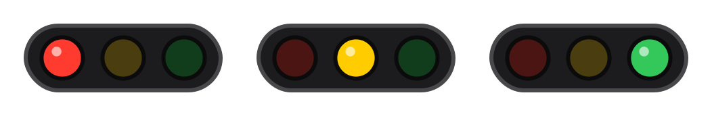
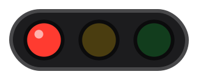
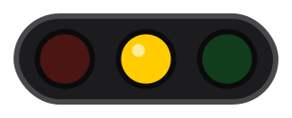
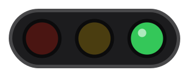
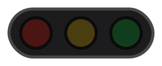

# 🚥 Clawd Traffic Light Theme

一个给 Clawd on Desk 桌宠用的横向红绿灯主题。看一眼桌面就知道 AI 编程助手（Codex、Claude Code、Cursor Agent 等）现在是什么状态。



## 状态说明

| 预览 | 灯 | 含义 | Clawd 状态 |
| --- | --- | --- | --- |
|  | 🔴 红灯（呼吸闪烁） | AI 正在思考 / 运行中 | `thinking` `working` `juggling` |
|  | 🟡 黄灯（快速闪烁） | 出错，或需要你处理（例如等待授权） | `error` `notification` |
|  | 🟢 绿灯（呼吸闪烁） | 任务完成 | `attention` |
|  | 🟢 绿灯（常亮） | 空闲 | `idle` `waking` |
|  | ⚫ 全灭 | 休眠 | `sleeping` |

## 安装

1. 下载本仓库，把 `traffic-light` 文件夹复制到 Clawd 的用户主题目录：
   - macOS：`~/Library/Application Support/clawd-on-desk/themes/`
   - 或在 Clawd 设置 → 主题 →「打开主题文件夹」
2. 在 Clawd 设置 → 主题 里点「刷新主题」。
3. 在「Traffic Light 🚥」卡片上点「装扮」。

也可以把 `traffic-light` 文件夹压缩成 zip，用「导入 Clawd 主题包 (.zip)」导入。

## 目录结构

```
traffic-light/
├── theme.json        # 主题配置（状态映射、尺寸、点击区域）
└── assets/
    ├── idle.svg      # 绿灯常亮
    ├── working.svg   # 红灯呼吸
    ├── error.svg     # 黄灯闪烁
    ├── success.svg   # 绿灯呼吸
    └── sleeping.svg  # 全灭
```

所有图像都是纯 SVG，动画用 SVG 自带的动画（SMIL）实现，没有外部依赖。想改颜色或闪烁速度，直接编辑 `assets/*.svg` 就行。

## License

MIT
